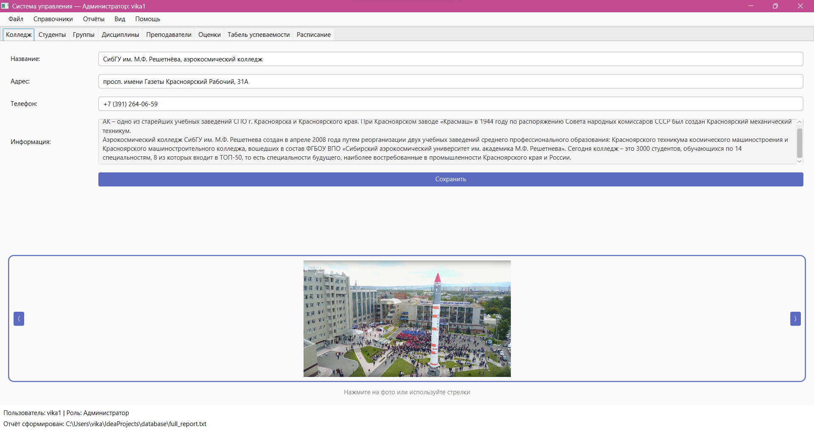
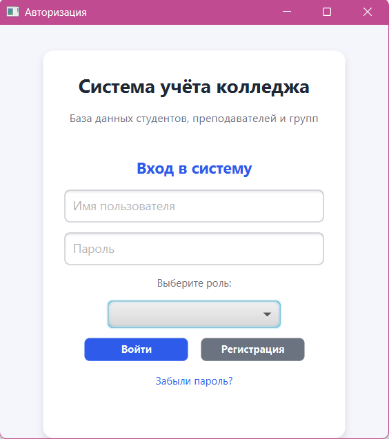
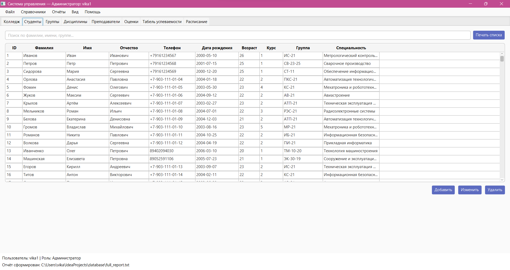
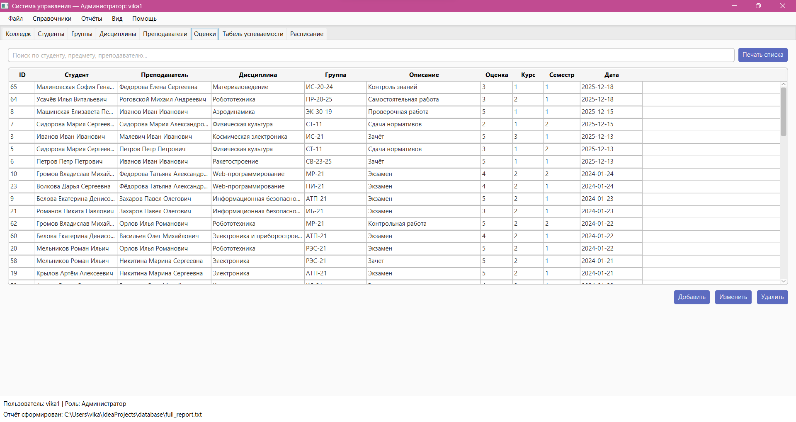
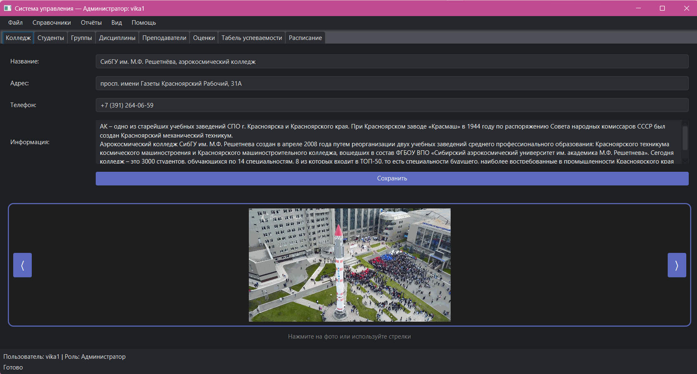

# АИС «Учёт студентов и оценок»

Учебный проект - автоматизированная информационная система для учёта студентов, преподавателей и успеваемости.

## О проекте

Приложение предназначено для автоматизации учёта учебной информации в образовательной организации. Система позволяет работать со сведениями о студентах, преподавателях, учебных группах, оценках и расписании.

Проект разработан на Java с использованием JavaFX и MySQL.

## Технологии

- **Java** - основной язык программирования.
- **JavaFX** - разработка графического интерфейса.
- **FXML** - описание интерфейса приложения.
- **JDBC** - взаимодействие с базой данных.
- **MySQL** - хранение информации.
- **Maven** - управление зависимостями и сборкой проекта.

## Функциональные возможности

- Авторизация пользователей.
- Управление данными студентов.
- Управление преподавателями и учебными группами.
- Учёт оценок и успеваемости.
- Расчёт среднего балла.
- Работа с расписанием.
- Поиск и фильтрация данных.
- Формирование и печать отчётов.
- Интерфейс со светлой и тёмной темами.

## Скриншоты

### Главное окно

### Авторизация

### Таблица студентов

### Учёт оценок

### Тёмная тема

## База данных

Для хранения информации используется MySQL.

Для создания структуры базы данных:

1. Открыть MySQL Workbench.
2. Выполнить SQL-скрипт `database/university_schema.sql`.
3. Создать файл `db.properties` на основе `db.properties.example`.
4. Указать собственные параметры подключения к MySQL.

SQL-скрипт создаёт базу данных `university` и необходимые таблицы.

Файл `db.properties` содержит локальные параметры подключения и не включается в репозиторий.

## Запуск проекта

1. Склонировать репозиторий.
2. Открыть проект в IntelliJ IDEA.
3. Загрузить зависимости Maven.
4. Настроить подключение к MySQL через `db.properties`.
5. Запустить приложение.

## Тестовые данные

В проекте используются вымышленные тестовые данные, предназначенные для демонстрации работы системы.

## Статус проекта

Учебный проект. Разработка и доработка функциональности выполняются в рамках обучения по специальности 09.02.07 «Информационные системы и программирование».
